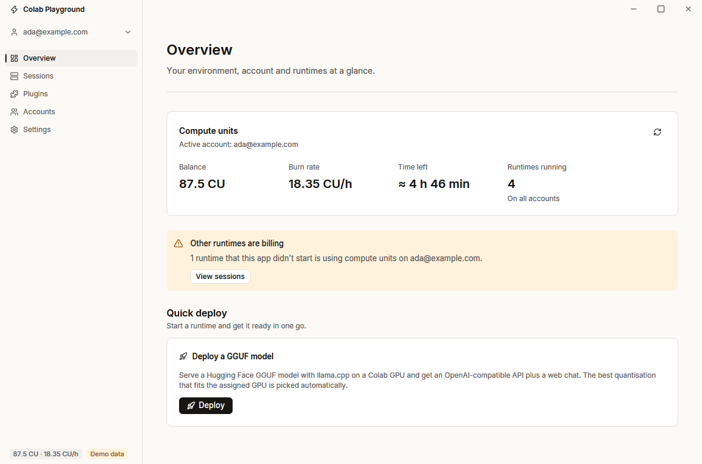
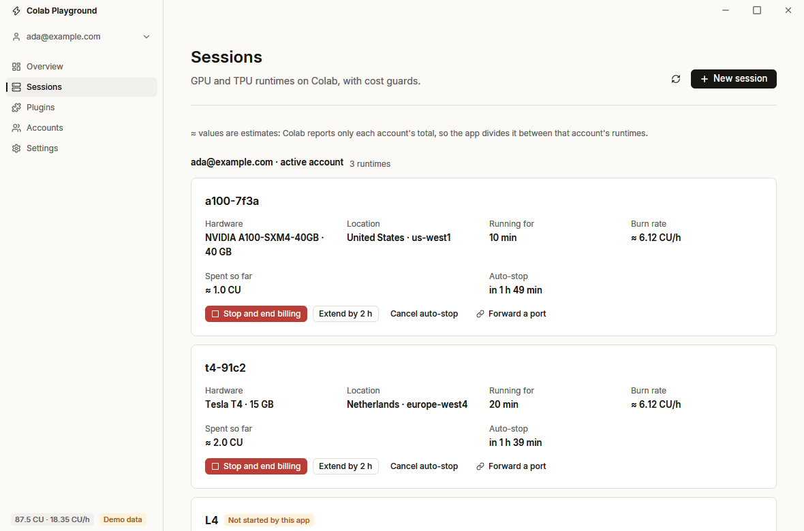

<div align="center">


# Colab Playground

[English](README.md) | **简体中文**

**Google Colab CLI 的桌面应用：多账号、带费用保护的 GPU 会话、端口转发和插件。**

[下载](https://github.com/scarletkc/colab-playground/releases/latest) | [使用说明](docs/USAGE.md) | [插件](docs/PLUGINS.md) | [路线图](docs/ROADMAP.md)

[](https://github.com/scarletkc/colab-playground/releases/latest)
[](https://github.com/scarletkc/colab-playground/actions/workflows/ci.yml)
[](https://www.gpui.rs/)
[](LICENSE)

[](https://github.com/scarletkc/colab-playground/releases/latest/download/colab-playground-x86_64-pc-windows-msvc.exe)
[](https://github.com/scarletkc/colab-playground/releases/latest/download/colab-playground-aarch64-apple-darwin.zip)
[](https://github.com/scarletkc/colab-playground/releases/latest/download/colab-playground-x86_64-unknown-linux-gnu.tar.gz)

下载哪个文件、第一次启动会问什么、怎么更新：见 [Install a release](docs/USAGE.md#install-a-release)。



</div>

**它是什么：** Google Colab CLI（命令 `colab`，软件包 `google-colab-cli`）的图形界面。它可以保存多个 Google 账号，在费用限制下启动和停止 Colab 运行时，把运行时上的端口转发到你的电脑，并在运行时上运行插件，例如用 llama.cpp 提供 GGUF 模型服务。使用 Rust、GPUI 和 [Ely GPUI Components](https://github.com/ELY-Open-Source/Ely-GPUI-Components) 编写。

**它不是什么：** 不是笔记本编辑器，也不能替代 CLI；所有操作都通过 `colab` 完成。部署模型不属于核心功能，而是一个插件（内置的 llama.cpp 插件）。

## 功能

- **引导式设置。** 一份检查清单会找到 Colab CLI（或替你安装），然后帮你登录。
- **多个 Google 账号。** 保存多个账号并随时切换，不用切换也能看到每个账号的余额。切换前，应用会列出这次切换会影响什么。
- **按需选择硬件的会话。** 可选 CPU、GPU 或 TPU、高内存以及最低显存。Colab 分配的 A100 随机是 40 GB 或 80 GB；设置了最低显存时，分到较小的 GPU 会退还并重试。在浏览器里打开的运行时也会列出来，并且可以停止。
- **费用保护。** 自动停止和空闲停止运行在运行时本身上，所以关掉应用也照样生效。应用运行时还会检查花费上限和余额下限。余额、消耗速度和剩余时间实时显示。
- **端口转发。** 把运行时上的端口连接到你电脑上的 `127.0.0.1`。
- **插件。** 一个清单文件加一个脚本，只在 Colab 运行时上运行，从不在你的电脑上运行。编写自己的插件见 [docs/PLUGINS.md](docs/PLUGINS.md)。
- **部署 GGUF 模型**（内置插件）。搜索 Hugging Face 上的模型，应用用 llama.cpp 提供服务：OpenAI 兼容 API 和网页聊天，并转发到你的电脑。它会根据分到的 GPU 选择放得下的最佳量化版本。
- **把模型存在 Google Drive。** 部署时开启 Google Drive，模型会保存在“我的云端硬盘 › Colab Playground”并直接从那里读取，再次部署同一个模型时不用重新下载。
- **部署记录。** 你启动过的每次部署都会列在单独的页面里，可以用同样的设置再部署一次。API 密钥等机密信息不会保存。
- **更新。** 应用会检查是否有新版本，在你确认后下载、校验签名并安装。
- **语言和主题。** English（默认）和简体中文；浅色、深色或跟随系统。

所有限制和默认值都可以在设置里修改，也可以针对单个会话或单次部署单独设置。

<p align="center">
  
  
</p>

## 获取

用上面的按钮下载适合你电脑的文件，或者用 Rust 工具链从源码运行。在 Windows 上，Colab CLI 运行在 WSL 里。

```sh
cargo run -p colab-playground              # 演示数据：不需要 Google 账号，不产生费用
cargo run -p colab-playground --release    # 真实的 Colab CLI
```

运行要求、后端参数、演示场景以及设置的存放位置：见 [docs/USAGE.md](docs/USAGE.md)。

## 安全与费用

- 只要运行时**存在**，Colab 就按计算单元计费，不管它是否在忙。关闭端口转发或关闭应用都不会停止计费；只有停止、自动停止或 Colab 自己回收运行时才会。
- 停止会清空运行时：文件、下载的模型，以及所有没有保存到 Google Drive 或其他地方的内容。每次分配后又退还的运行时，都会按它存在的那一小段时间计费。
- Google Drive 默认关闭，只在你为某次部署开启时才挂载。挂载期间，运行时上的代码（包括插件）可以读取和修改你的整个 Drive。每台新运行时都需要在浏览器里重新授权一次。
- 花费上限和余额下限只在应用运行时生效。自动停止和空闲停止运行在运行时上，前提是它的看门狗成功启动（启动失败时应用会提示）。
- CLI 在整台电脑上只有一个登录账号。在应用里切换账号，其他地方使用的 `colab` 也会跟着切换；留在旧账号上的运行时会继续计费，直到它的自动停止生效（如果设置了的话）。
- 不是由本应用启动的运行时（例如在浏览器里打开的）不会被设置自动停止；它们会被列出来，方便你停止。
- 插件会在你付费的运行时上运行它的脚本。只安装你信任的插件。
- 未知的用量绝不会显示为零：会标为未知或已过期，费用保护也会提示在用量未知时无法检查限制。

## 文档

以下文档为英文。

- [docs/USAGE.md](docs/USAGE.md)：安装发布版、构建和运行、演示数据、文件存放位置。
- [docs/PLUGINS.md](docs/PLUGINS.md)：编写插件（清单、环境变量、状态、安全）。
- [docs/DESIGN.md](docs/DESIGN.md)：产品原则、范围，以及每次改动都要遵守的规则。
- [docs/TESTING.md](docs/TESTING.md)：改动怎么检查，以及真实模式下可选的检查清单。
- [docs/DEVELOPMENT.md](docs/DEVELOPMENT.md)：文档和注释怎么写、通过 Pull Request 合入改动、处理评审机器人的评论。
- [docs/COLAB_NOTES.md](docs/COLAB_NOTES.md)：本应用所依据的 Colab 和 CLI 行为。
- [docs/ROADMAP.md](docs/ROADMAP.md)：已规划但还没实现的功能。
- [docs/RELEASING.md](docs/RELEASING.md)：发布流程，以及每个下载文件里有什么。

## 许可证

MIT，© 2026 ScarletKc。见 [LICENSE](LICENSE)。图标来自 [Lucide](https://lucide.dev)（ISC 许可证，见 [assets/icon/LICENSE-lucide.txt](assets/icon/LICENSE-lucide.txt)）。
